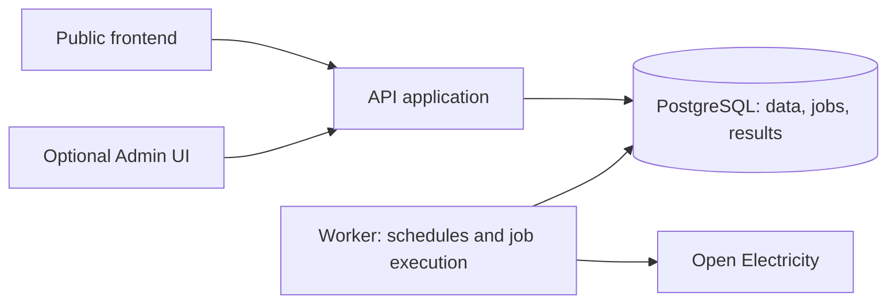

# NEMLab architecture

Updated: 2026-09-21
Status: Plain Java core, fixed schedule and ordered-window hindsight implemented and tested; separate API/worker application shells now run; versioned PostgreSQL price storage/import is implemented; opt-in scheduled worker execution is implemented; opt-in protected operator APIs are implemented; stored-price read endpoints are implemented; the separate frontend repository and build baseline are verified; simulation request normalisation and immutable price-input capture are implemented; durable simulation execution/results are implemented; simulation HTTP APIs are implemented; GridReplay APIs and frontend product integration remain planned.

## Agreed boundaries

One backend repository and one frontend repository. The backend uses Java and Spring Boot, with separately runnable API and worker applications. Admin may become a second application in the frontend repository. See [repository decision](decisions/002-repositories-and-applications.md).

Java 25 LTS is accepted. The first-build baseline is OpenJDK 25.0.4+7, Gradle 9.7.1 and Spring Boot 4.1.1. M2 starts with a plain Java core and tests; Boot applications arrive in M3. The Java 25 core build/tests pass with the pinned wrapper and locked JUnit 6.1.3 dependencies. ojAlgo 57.3.0 also passes the bounded engine evaluation. Boot 4.1.1 API/worker contexts and executable-jar startup checks now pass; see [foundation evidence](evidence/foundation/findings.md). See [runtime decision](decisions/004-java-runtime.md).

## Module structure and planned frontend

```text
nemlab/                         Backend project, already created
  core/                         Domain models and feature services
  infrastructure/               OE price adapter, JDBC revisions/coverage, backfill checkpoints
  api/                          Spring Boot HTTP entry point
  worker/                       Non-web Boot worker; opt-in scheduling and bounded fetch processes
  docs/                         Canonical project documentation

nemlab-ui/                      Separate frontend repository
  apps/public/                  Public React application
  contracts/                    Versioned OpenAPI snapshot and generated types
  tests/                        Playwright browser checks
  scripts/                      Contract checks and real-backend verification
```

Dependency direction: API and worker depend on core/infrastructure; infrastructure implements interfaces defined by core; core does not depend on either runnable app or infrastructure. Package core by `marketdata`, `batterylab`, `gridreplay`, and `jobs`. Keep battery mathematics free of Spring and database concerns. Avoid cyclic module dependencies and a catch-all shared utilities module.

## Runtime flow



The API validates requests, reads stored series/results, and persists jobs. Schedules create the same job type as manual refresh requests. Workers claim jobs, retrieve OE inputs, validate/persist data, and run computations. Public traffic never directly triggers an unbounded OE fetch. Browsers poll job status, then animate loaded data locally.

## Proposed technology choices

PostgreSQL/Flyway/JDBC price storage is implemented under [decision 008](decisions/008-price-data-foundation.md). Spring MVC and Actuator are implemented in the API shell; the worker uses the non-web Boot starter. The React/TypeScript/Vite foundation is accepted and verified under [decision 011](decisions/011-frontend-foundation.md). Remaining libraries in [decision 005](decisions/005-infrastructure-and-frontend.md) are proposals; verify versions, licences and compatibility when implementing their slices.

| Area | Proposed choice | Purpose |
| --- | --- | --- |
| Build | Gradle wrapper, Java toolchain | Reproducible backend builds |
| API | Spring MVC, Bean Validation, Spring Security | HTTP contracts, input checks, authorisation |
| Persistence | PostgreSQL, Flyway, Spring JDBC for bulk/time-series queries | Explicit SQL, schema versioning and transactional jobs |
| Operations | Spring Boot Actuator and structured logs | Health, metrics and job diagnostics |
| Frontend | React, TypeScript, Vite | Interactive public app and later Admin |
| Navigation/data | React Router, TanStack Query | Shareable routes, caching and job polling |
| Forms/UI | React Hook Form, Zod, shadcn/ui, Tailwind CSS | Validated inputs and reusable controls |
| Charts/tables | Apache ECharts, TanStack Table | Aligned time-series views and administrative tables |
| Verification | JUnit, database integration tests, Playwright | Domain invariants, persistence recovery, visitor journeys |

ojAlgo 57.3.0 is selected for the exact ordered-window LP, with independent dispatch/accounting checks and a dual bound; see [solver decision](decisions/007-hindsight-solver.md) and [measurements](evidence/engine/findings.md). Unrestricted optimisation is deferred. Do not require a Python production service merely for optimisation. No broker, distributed cache, Kubernetes, time-series extension, or separate Admin backend is needed by the initial design.

## Data ownership and reproducibility

Conceptual records, to refine into migrations:

- Series identity: source, region/entity, metric, resolution and unit.
- Observation versions: canonical interval, value or missing status, source retrieval and revision provenance.
- Coverage windows: expected/observed intervals, completeness and validation findings.
- Ingestion runs and durable jobs: requested window, checkpoint, attempts and errors.
- Simulation input snapshots: normalised parameters, exact ordered prices, checksum, strategy/model versions.
- Results: interval dispatch and energy, accounting totals, solver status and methodology version.
- Replay events: detector version/configuration, source revision, period, evidence and coverage.
- Administrator actions: actor, requested scope, timestamp and resulting job.

Use UTC instants in storage and explicit fixed UTC+10 NEM market-day interpretation at boundaries; preserve source timestamp semantics in provenance. API fields must state interval labels and units. Missing observations remain distinct from zero. Do not silently rewrite a historical result when an observation is refreshed; preserve its input snapshot. Data/results retention and cleanup need an explicit policy before public traffic.

## Durable jobs and scheduling

Implemented for one-day price refreshes: queued, running, succeeded, failed, cancelled. The Spring-managed `RefreshJobService` uses `@Transactional` and PostgreSQL row/advisory locks. A five-minute lease and unique claim token fence price writes, checkpoint advancement and job completion in one transaction. Expired claims recover on the next claim request, with at most three attempts and 30/60-second retry backoff. The queue caps pending work at 100 and allows one current ingestion claim across worker processes. Network calls must happen outside these transactions.

Stable request keys persist across completion; concurrent requests for an active region/day share a job. Every submission and transition records an actor/action. This service is an internal persistence boundary, not an authentication boundary. NEM-029 wires opt-in worker polling and daily submissions after 00:15 fixed UTC+10 through this service. Fetches run in a separate 128 MiB-heap JVM with a 240-second parent deadline, child watchdog and shutdown cleanup. Non-429 HTTP 4xx, invalid source/configuration and excessive Retry-After delays fail terminally; other failures retain bounded retries. NEM-030 adds opt-in bearer-authenticated operator submission, status, recent jobs, audit events and cancellation. The configured principal supplies audit identity; no client actor is trusted. Direct CLI ingestion is retired. See [operator setup](../../api/README.md). See [decision 009](decisions/009-durable-refresh-queue.md), [queue verification](evidence/jobs/findings.md), and [worker verification](evidence/jobs/worker-findings.md).

Deduplicate equivalent refreshes and scenario submissions using stable input keys. Save backfill checkpoints. Keep simulation and ingestion concurrency separately bounded; prevent overlap from repeated schedules. Manual triggers return job IDs immediately. Cancellation and progress detail can be refined with actual job types.

Begin with one worker instance and jointly released backend applications. Design restart recovery now; broader worker scaling can follow measured demand. Run database migrations once per deployment through a documented step, not competing uncontrolled startup migrations.

## Proposed API surfaces

Final schemas and endpoints are a M3 deliverable. Initial resources cover coverage, bounded regional series, simulation submission/status/results, event catalogue/replay, and protected admin job/refresh operations. Use a versioned API contract, machine-readable errors, explicit units/time semantics, paging/window limits, and generated frontend types. Keep generated contracts versioned across the two repositories; do not share Java persistence entities with the client.

Anonymous public use is a proposal; constrain request size, queue depth and compute duration. Shared results use opaque identifiers and a defined retention policy. Administrative endpoints require server-side authorisation and audit records even if the UI is deferred. OE keys remain server-side. Authentication provider/session details are an open launch decision.

## Deployment and verification

Proposed initial deployment: static frontend, API process/container, worker process/container, and PostgreSQL. Hosting and cost limits remain open. Use environment-specific configuration, persistent database storage, safe schema rollouts, backups, restore verification, and a release smoke check.

Verify physical/accounting invariants independently of optimiser implementation; exercise database rollback, duplicate ingestion, expired leases and revision handling with integration tests. Browser checks cover a saved BatteryLab result and a GridReplay-to-BatteryLab journey. Set measurable performance budgets after the engine/data spikes; do not invent latency promises now.

See [blockers](blockers.md) for unresolved choices and [roadmap](roadmap.md) for implementation gates.


## Stored-price read API — NEM-031

`NEMLAB_DATA_ENABLED` independently enables anonymous GET coverage and current-day price series
under `/api/v1/prices`. API database wiring is shared with opt-in operator controls, whose bearer
boundary remains intact. Coverage uses one bounded query for 1–31 completed NEM days; series
load the captured immutable revision and return exactly 288 slots with explicit gap states.
Prices are decimal strings in AUD/MWh; interval boundaries are UTC instants with fixed +10:00
market-day metadata. Reads neither enqueue work nor contact OE. Responses are not cacheable
across corrections. See the [endpoint contract](../../api/README.md#public-stored-price-reads).
NEM-032 implements the versioned [OpenAPI contract and generated TypeScript declarations](../../api/contracts/README.md). The checked-in contract owns the seven enabled price/operator operations; Java HTTP tests provide response captures validated against it during the Gradle build. Generation and validation are pinned Node development tooling, not application runtime dependencies. See the contract guide for compatibility, regeneration and the future frontend handoff.

## Frontend foundation

NEM-033 creates the separate `nemlab-ui/.git` repository. Its npm workspace contains
one static public app in `apps/public`, with React 19.3.0, TypeScript 5.9.3 and Vite 8.3.0.
Pinned Node/npm tooling, Prettier, strict compilation and production-browser checks
are described in [decision 011](decisions/011-frontend-foundation.md). A future Admin
would use a separate application/build in this repo; none exists now.

The current landing page needs no backend or credentials. NEM-034 implements public navigation, shared layout and methodology with React Router 8.4.0 and plain CSS; see [decision 012](decisions/012-public-navigation.md).
NEM-035 implements the typed public price client and coverage/day table, backed by a versioned contract snapshot and verified against the real Java API. [Decision 013](decisions/013-typed-price-client.md) records client/cache choices and contract ownership. NEM-036 verifies linked charts with lazy-loaded ECharts 6.1.0, SVG rendering, shared interval/window state and native keyboard/touch controls. [Decision 014](decisions/014-linked-chart-prototype.md) records measured limits; the companion trace is explicitly synthetic, not simulation output.
The backend remains the only owner of project-wide tracking and API contracts.

NEM-042 adds centered BatteryLab/full-width GridReplay layouts and a shared appearance provider. CSS semantic colors and native control color schemes support Light/Dark/Auto, restored before first paint with a same-origin script. ECharts responds to the resolved theme while preserving selected interval/window. Preferences persist locally, sync across tabs and fall back to in-memory state when storage is unavailable. See [decision 018](decisions/018-product-layouts-and-appearance.md).

NEM-043 implements the accepted revision after UI review (2026-09-24): center both product workspaces, cap BatteryLab at 1160px and GridReplay at 1440px, and use the same centered 1160px header/navigation container including gutters. The full-width GridReplay description above records NEM-042 history. Appearance behavior is unchanged.

NEM-043 adds a separate typed simulation client for POST submission and UUID-based GET status/result reads. URLs are constructed locally, never followed from response links; cookies/credentials are omitted, redirects rejected, and requests time out after 15 seconds. The form preserves decimal strings, uses fixed-scale BigInt for exact bound comparisons, and checks complete stored prices before submission. The server remains authoritative. A component-owned AbortController cancels monitoring on stop/unmount, with inputs locked while busy and prior job/result cleared on edits. Polling honors bounded Retry-After and pauses after 60 waits; resuming uses the same job ID and POST is never automatically retried. Validated stored result payloads are retained for NEM-044 presentation. Saved-route reopening remains NEM-045.

NEM-044 renders the stored comparison in a `ResultView` section: stat cards, derived explanations, financial breakdown and an exact-value interval table, plus a lazily loaded `ResultCharts` bundle that draws four linked panels (price, grid-side power, stored energy, cumulative margin) with one cursor/window selection, operating-window and negative-price bands, and energy bounds. Displayed totals come from the stored accounting; client-side cumulative margin recomputes the same formula per interval for the trace only. Failed chart chunk loads leave the tables available. Saved-route reopening remains NEM-045.


## Simulation request preparation — NEM-039

The core `SimulationRequest` normalises exact decimal parameters, mutually exclusive
efficiency forms and ordered NEM-time windows, returning field/code validation errors.
It reuses the existing engine models; admission limits do not widen solver proof tolerances.
Infrastructure `ScenarioPreparation` captures one immutable stored price revision and a
versioned SHA-256 scenario identity including normalised inputs, engine/strategy/solver
versions and cooperative solver limits. Preparation is read-only and never queues ingestion.
NEM-040 implements transactional persistence of the captured revision with jobs/results; NEM-041
owns HTTP integration. See [request contract](features/simulation-request-contract.md) and
[decision 015](decisions/015-simulation-request-boundary.md).


## Durable simulations — NEM-040

Flyway V3 adds immutable `simulation_input` and `simulation_result` records plus a mutable
`simulation_job` lifecycle. `SimulationJobs` uses explicit 30-second transactions, a separate
queue advisory lock, a unique scenario key and one globally running simulation. Pending
capacity is 100; 60-second claims permit at most three attempts with 5/10-second backoff.
Input revision and normalised request/version metadata are inserted atomically with the job.
Completed and failed scenario keys remain deduplicated; resubmission does not reset them.

An independently enabled `SimulationWorker` shares database configuration with ingestion
but requires no OE key. Each child gets a 512 MiB heap, two active processors, a cleared
environment and the stored 5-second/100,000-iteration solver budget. Parent and child
watchdogs enforce 15 seconds; termination confirmation gets five seconds. The parent
rechecks fixed dispatch, physical/accounting invariants and optimality metadata before
an atomic immutable result/terminal-status transaction. Publication rechecks lease/token
so expired workers cannot commit. Only OPTIMAL succeeds; unproven/failed solver outcomes
remain diagnostic results on failed jobs. See [decision 016](decisions/016-durable-simulations.md),
[worker setup](../../worker/README.md#simulation-execution) and [verification](evidence/engine/execution-findings.md).


## Simulation HTTP lifecycle — NEM-041

`NEMLAB_SIMULATION_API_ENABLED` independently enables public POST submission and GET
status/result resources under `/api/v1/simulations`. JSON bodies are bounded at 16384
bytes with strict decimal strings, integer window minutes, known fields, unique keys
and one document. NEM-039 validation and NEM-040 queue semantics are reused. Pending
submissions return 202; terminal duplicates return 200 without resetting work.

Public DTOs omit tokens, leases, internal scenario keys and raw solver diagnostics.
Only successful OPTIMAL comparisons have a public result; pending/failed runs return
409. Exact normalised inputs/prices, immutable revision/version metadata and unrounded
engine dispatch/accounting are returned with units/time boundaries. OpenAPI 1.1.0 adds
three operations and generated TypeScript inputs without changing price/operator schemas.
See [decision 017](decisions/017-simulation-http-contract.md), [API setup](../../api/README.md#public-simulation-lifecycle)
and [verification](evidence/engine/http-findings.md).
