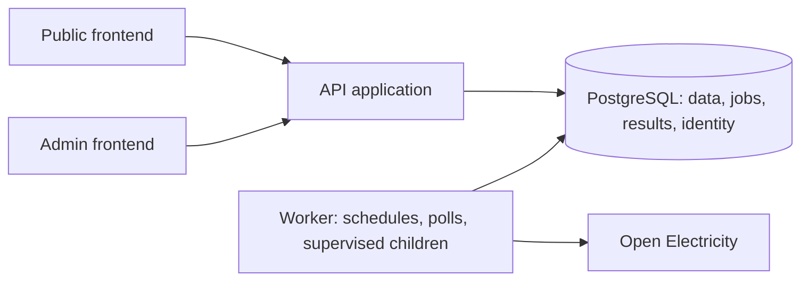

# NEMLab architecture

Updated: 2026-10-09  
Status: The Python backend is the active runtime — `nemlab_core`, `nemlab_infrastructure`, `nemlab_api` and `nemlab_worker` under a uv workspace, built on CPython 3.13, FastAPI/Uvicorn/Pydantic, PostgreSQL via SQLAlchemy 2 Core/Psycopg 3 with explicit SQL, Alembic migrations and SciPy/HiGHS. Local parity with the former Java implementation is verified (NEM-080). BatteryLab (M4), GridReplay including detector v2 discovery (M5) and Admin including the desktop workspace redesign (M6) are delivered as local feature milestones. Remaining gates are M7 launch work: hosted CI (NEM-038), deployment/operations verification (NEM-020) and carried GridReplay hardening (NEM-094). The Java implementation is preserved under `reference/java/` as the runnable baseline — see [Java reference implementation](#java-reference-implementation).

## Agreed boundaries

One backend repository and one frontend repository. The backend is Python with separately runnable API and worker applications sharing one PostgreSQL database; Admin is a second, separately built application in the frontend repository. See [repository decision](decisions/002-repositories-and-applications.md) (boundary retained; language superseded) and [Python rebuild decision](decisions/019-python-backend-rebuild.md).

CPython `==3.13.*` is pinned at the workspace root; uv `>=0.11` manages the workspace and lockfile; packages build with hatchling. The active stack was selected under delegated authority in decision 019 and refined after [energy-stack research](evidence/python-rebuild/energy-python-stack-research.md): FastAPI rather than Django, SQLAlchemy Core rather than an ORM, and no Redis/Celery — the existing PostgreSQL durable queue is retained.

## Module structure

```text
nemlab/                         Backend repository (uv workspace root)
  core/                         nemlab_core — domain: prices/market days, battery models,
                                dispatch/hindsight, request normalisation, grid detectors
  infrastructure/               nemlab_infrastructure — PostgreSQL stores, OE price/grid
                                source adapters, refresh/simulation/grid job services,
                                admin identity/auth/access, mail outbox, migrations runner
  api/                          nemlab_api — FastAPI entry point, feature-flagged routers,
                                contracts/ versioned OpenAPI snapshot + generated types
  worker/                       nemlab_worker — non-HTTP process: opt-in pollers and
                                supervised fetch/simulation/grid child processes
  migrations/                   Alembic environment and revisions (baseline + V4–V10)
  reference/java/               Frozen Java-era tree, still runnable (see below)
  docs/                         Canonical project documentation

nemlab-ui/                      Separate frontend repository
  apps/public/                  Public React application
  apps/admin/                   Admin React application (separate build/style system)
  contracts/                    Versioned OpenAPI snapshot and generated types
  tests/, tests-admin/          Playwright browser checks (public and admin suites)
  scripts/                      Contract checks and real-backend verification
```

Dependency direction: API and worker depend on core/infrastructure; infrastructure may use core; core depends on neither runnable app nor infrastructure. The direction is enforced by an import-linter `layers` contract (`nemlab_api | nemlab_worker` over `nemlab_infrastructure` over `nemlab_core`) — api and worker are independent siblings. Keep battery mathematics free of HTTP and database concerns. Avoid cyclic module dependencies and a catch-all shared utilities module.

## Runtime flow



The API validates requests, reads stored series/results/catalogue and persists jobs and identity records. Schedules create the same job type as manual refresh requests. The worker claims jobs, retrieves OE inputs inside supervised child processes, validates/persists data, runs computations and drains the mail outbox. Public traffic never directly triggers an unbounded OE fetch. Browsers poll job status, then animate loaded data locally.

## Technology choices

All backend rows are implemented and verified; frontend rows follow [decisions 011–014, 018 and 025](decisions/011-frontend-foundation.md).

| Area | Choice | Purpose |
| --- | --- | --- |
| Build | uv workspace + lockfile, hatchling, `==3.13.*` pin | Reproducible backend builds |
| API | FastAPI, Uvicorn, Pydantic 2, pydantic-settings | HTTP contracts, input checks, typed settings |
| Persistence | PostgreSQL, Alembic, SQLAlchemy 2 Core + Psycopg 3, explicit `text()` SQL | Explicit SQL, schema versioning and transactional jobs |
| HTTP client | httpx | Bounded OE requests in fetch children |
| Solver | SciPy `linprog`/HiGHS | Exact ordered-window LP parity with the Java baseline |
| Operations | Structured logging, `/actuator/health` parity, Docker api/worker/migrate targets | Health, job diagnostics, packaging |
| Frontend | React 19, TypeScript, Vite | Interactive public app and separate Admin app |
| Navigation/data | React Router, TanStack Query | Shareable routes, caching and job polling |
| Charts/tables | Apache ECharts, TanStack-style tables | Aligned time-series views and administrative tables |
| Verification | pytest, hypothesis, import-linter, Testcontainers-style PostgreSQL, Playwright | Domain invariants, module boundaries, persistence recovery, visitor journeys |

Unrestricted optimisation remains deferred; Pyomo is a future modelling option, not a present dependency. No broker, distributed cache, Kubernetes, time-series extension, or separate Admin backend is needed by the current design.

## Data ownership and reproducibility

The conceptual records below are now realised as Alembic revisions: `nemlab_baseline_v1_v3` adopts the Java Flyway V1–V3 schema byte-identically (price revisions/current/attempts/snapshots/backfill, refresh jobs, simulation inputs/jobs/results), then V4 grid observations, V5 grid import jobs, V6 grid events, V7 detector v2, V8 `admin_*` identity, V9 publication provenance and V10 load operations.

- Series identity: source, region/entity, metric, resolution and unit.
- Observation versions: canonical interval, value or missing status, source retrieval and revision provenance.
- Coverage windows: expected/observed intervals, completeness and validation findings.
- Ingestion runs and durable jobs: requested window, checkpoint, attempts and errors.
- Simulation input snapshots: normalised parameters, exact ordered prices, checksum, strategy/model versions.
- Results: interval dispatch and energy, accounting totals, solver status and methodology version.
- Replay events: detector version/configuration, source revision, period, evidence and coverage; publication pointers with provenance.
- Administrator/owner/viewer identity, sessions, grants, access audit and rate-limit counters.
- Load-operation records referencing durable grid/price jobs; administrator actions: actor, scope, timestamp and resulting job.

Use UTC instants in storage and explicit fixed UTC+10 NEM market-day interpretation at boundaries; preserve source timestamp semantics in provenance. API fields must state interval labels and units. Missing observations remain distinct from zero. Do not silently rewrite a historical result or replay link when an observation is refreshed; preserve its input snapshot. Data/results retention and cleanup need an explicit policy before public traffic.

## Durable jobs and scheduling

Implemented for one-day price refreshes: queued, running, succeeded, failed, cancelled. `RefreshJobService` uses SQLAlchemy transaction blocks and PostgreSQL row/advisory locks. A five-minute lease and unique claim token fence price writes, checkpoint advancement and job completion in one transaction. Expired claims recover on the next claim request, with at most three attempts and 30/60-second retry backoff. The queue caps pending work at 100 and allows one current ingestion claim across worker processes. Network calls happen outside these transactions.

Stable request keys persist across completion; concurrent requests for an active region/day share a job. Every submission and transition records an actor/action. This service is an internal persistence boundary, not an authentication boundary. Opt-in worker polling (`NEMLAB_WORKER_ENABLED`) and daily submissions after 00:15 fixed UTC+10 run through this service. Fetches run in a supervised child process (`--fetch-price` mode, no database credentials) with a 240-second parent deadline, in-child watchdog and 5-second shutdown cleanup. Non-429 HTTP 4xx, invalid source/configuration and excessive Retry-After delays fail terminally; other failures retain bounded retries. Grid imports use the same supervised-child pattern (`NEMLAB_GRID_IMPORT_ENABLED`, `GridImportJobs`, V5 jobs). See [decision 009](decisions/009-durable-refresh-queue.md), [queue verification](evidence/jobs/findings.md), and [worker verification](evidence/jobs/worker-findings.md).

Deduplicate equivalent refreshes and scenario submissions using stable input keys. Save backfill checkpoints. Keep simulation and ingestion concurrency separately bounded; prevent overlap from repeated schedules. Manual triggers return job IDs immediately. NEM-046 lets public simulation submissions trigger refreshes for eligible uncovered days: `submitVisitor` uses `visitor-price-v1` request keys, deduplicates onto any active day job, allows three attempts per day via `:rN` suffixes and ten pending visitor jobs globally, all inside the same advisory-locked queue transaction. The API answers `PRICE_REFRESH_PENDING`/`PRICE_REFRESH_FAILED`/`VISITOR_REFRESH_LIMIT` instead of exposing queue internals, and the browser resubmits the unchanged scenario after each `Retry-After`.

Begin with one worker instance and jointly released backend applications. Restart recovery is designed in; broader worker scaling can follow measured demand. Database migrations run once per deployment through the `migrate` image/`nemlab_infrastructure.migrate` command, not competing uncontrolled startup migrations.

## API surfaces

The API is implemented behind independent feature flags; disabled routers are not mounted (plain 404) and enabled features fail startup fast without database credentials or a migrated schema.

- `GET /actuator/health` — always on, `{"status": "UP"}`.
- `NEMLAB_DATA_ENABLED` — anonymous stored-price coverage/day series under `/api/v1/prices`, plus the public GridReplay catalogue/replay/highlight/preview routes.
- `NEMLAB_SIMULATION_API_ENABLED` — public simulation POST submission and GET status/result under `/api/v1/simulations`.
- `NEMLAB_ADMIN_ENABLED` — bearer operator routes (`/api/admin/v1/price-refreshes*`, grid imports/coverage/publications, load operations), browser auth (`/api/auth/v1/*`), public access requests and owner access-management routes, all enforced by the `AdminAccess` capability middleware.

Contracts are versioned in `api/contracts/openapi.json` (currently 2.2.0) with generated TypeScript for the frontend; `verify.mjs` checks captured responses. Public DTOs omit tokens, leases, internal keys and raw solver diagnostics. Anonymous public use constrains request size, queue depth and compute duration. OE keys remain server-side. See [decision 017](decisions/017-simulation-http-contract.md) and [API setup](../../api/README.md).

## Stored-price read API — NEM-031

`NEMLAB_DATA_ENABLED` independently enables anonymous GET coverage and current-day price series under `/api/v1/prices`. Coverage uses one bounded query for 1–31 completed NEM days; series load the captured immutable revision and return exactly 288 slots with explicit gap states. Prices are decimal strings in AUD/MWh; interval boundaries are UTC instants with fixed +10:00 market-day metadata. Reads neither enqueue work nor contact OE. Responses are not cacheable across corrections. See the [endpoint contract](../../api/README.md).

NEM-032 implements the versioned OpenAPI contract and generated TypeScript declarations; the checked-in contract owns the enabled operations and is validated against live captures. Generation and validation are pinned Node development tooling, not application runtime dependencies.

## Simulation lifecycle — NEM-039–NEM-041

The core `SimulationRequest` normalises exact decimal parameters, mutually exclusive efficiency forms and ordered NEM-time windows, returning field/code validation errors; admission limits do not widen solver proof tolerances. Infrastructure `ScenarioPreparation` captures one immutable stored price revision and a versioned SHA-256 scenario identity including normalised inputs, engine/strategy/solver versions and cooperative solver limits. See [request contract](features/simulation-request-contract.md) and [decision 015](decisions/015-simulation-request-boundary.md).

The Alembic baseline carries immutable `simulation_input`/`simulation_result` records plus the mutable `simulation_job` lifecycle. `SimulationJobs` uses explicit 30-second transactions, a separate queue advisory lock, a unique scenario key and one globally running simulation. Pending capacity is 100; 60-second claims permit at most three attempts with 5/10-second backoff. Completed and failed scenario keys remain deduplicated.

An independently enabled simulation worker (`NEMLAB_SIMULATION_ENABLED`) shares database configuration but requires no OE key. Each child gets a 4 GiB address-space limit (`RLIMIT_AS`), a cleared environment and the stored solver budget; parent and in-child watchdogs enforce 15 seconds plus 5-second termination. The parent rechecks fixed dispatch, physical/accounting invariants and optimality metadata before an atomic immutable result/terminal-status transaction; publication rechecks lease/token so expired workers cannot commit. Only OPTIMAL succeeds. See [decision 016](decisions/016-durable-simulations.md), [worker setup](../../worker/README.md) and [verification](evidence/engine/execution-findings.md).

`NEMLAB_SIMULATION_API_ENABLED` mounts public POST submission and GET status/result under `/api/v1/simulations`: JSON bodies bounded at 16384 bytes with strict decimal strings, integer window minutes, known fields and unique keys. Pending submissions return 202; terminal duplicates return 200 without resetting work. Pending/failed runs return 409 on result reads. See [decision 017](decisions/017-simulation-http-contract.md) and [verification](evidence/engine/http-findings.md).

## GridReplay — delivered (M5)

Versioned grid observations and per-metric coverage (V4), bounded operator import jobs through the supervised worker pattern (V5), deterministic detectors in `nemlab_core` (fixed-window spike/ramp rules, then calibrated detector v2 in V7) and atomic event/replay publication (V6) are implemented. Publication pointers carry provenance (V9): replay data and pagination are pinned to an immutable publication so corrected source data cannot silently alter old replay links. Public catalogue, event detail, preview and replay endpoints are read-only and bounded under `NEMLAB_DATA_ENABLED`; they never initiate OE requests. Discovery releases added publication-wide highlights, typed filters, bounded event previews and the v2 detector suite (unusual ramps, negative-to-high reversals, related negative episodes) — see [decision 022](decisions/022-detector-v2-definitions.md) and the [M5 state review](evidence/m5-state-review-2026-10-08.md).

## Admin — delivered (M6)

[Decision 024](decisions/024-admin-experience-and-access.md) selects a separate same-origin Admin build backed by the existing API/PostgreSQL. Implemented: the V8 `admin_*` identity storage (users, access requests, viewer grants, hashed tokens, sessions, email outbox, access audit, rate-limit counters) and CLI owner bootstrap under `nemlab_infrastructure.admin`; single-use hashed email sign-in tokens exchanged for opaque server sessions with CSRF/origin checks and shared rate limits (`/api/auth/v1/*`), with the worker draining the outbox to a captured mailbox (`NEMLAB_MAIL_ENABLED` — no live-recipient transport yet); the deny-by-default `capabilities.py` route table enforced by `AdminAccess` middleware resolving session-cookie or bearer identities and serving viewer-safe projections; the access-request lifecycle (submission dedupe, verification, atomic approve/reject/extend/revoke, retention pruning) under `access.manage` with a 15-minute recent-auth check; bounded console reads including ramp-baseline readiness; and V10 persisted load operations referencing durable grid/price jobs — not a second queue. Existing bearer automation is retained separately and cannot manage browser accounts. Publication stays explicit and atomic. See the [specification](features/admin.md) and [M6 review](evidence/admin-redesign/m6-review.md).

[Decision 025](decisions/025-admin-desktop-workspace.md) delivered the independent Admin stylesheet/token system and full-viewport Data Operations/Access workspaces in `apps/admin` (NEM-108–115), verified by the dedicated admin Playwright suite and the recorded M6 acceptance review.

## Frontend foundation

NEM-033 created the separate `nemlab-ui/.git` repository. Its npm workspace contains the public app in `apps/public` (React 19.3.0, TypeScript 5.9.3, Vite 8.3.0) and the Admin app in `apps/admin` (separate build and style system). Pinned Node/npm tooling, Prettier, strict compilation and production-browser checks are described in [decision 011](decisions/011-frontend-foundation.md).

NEM-034 implements public navigation, shared layout and methodology with React Router 8.4.0 and plain CSS; see [decision 012](decisions/012-public-navigation.md). NEM-035 implements the typed public price client and coverage/day table, backed by a versioned contract snapshot and verified against the real API ([decision 013](decisions/013-typed-price-client.md)). NEM-036 verifies linked charts with lazy-loaded ECharts 6.1.0 ([decision 014](decisions/014-linked-chart-prototype.md)). NEM-042/043 add centered product workspaces, shared appearance (Light/Dark/Auto) and a typed simulation client with bounded polling. NEM-044 renders the stored comparison (stat cards, financial breakdown, interval table, four linked chart panels). NEM-045 makes results reopenable through `?simulation=<uuid>` route state. The backend remains the only owner of project-wide tracking and API contracts.

## Deployment and verification

Target deployment: static frontend builds, API container, worker container, migrate job and PostgreSQL. The multi-stage `Dockerfile` builds `api`, `worker` and `migrate` targets on `python:3.13.14-slim` with pinned uv; `compose.yaml` wires local services. Hosting, real SMTP, TLS, backups and cost limits remain open M7 items.

Verify physical/accounting invariants independently of optimiser implementation; exercise database rollback, duplicate ingestion, expired leases and revision handling with integration tests. Browser checks cover a saved BatteryLab result and a GridReplay-to-BatteryLab journey in both public and admin Playwright suites. Hosted CI verification remains open under NEM-038 (no remote yet — BLK-007).

See [blockers](blockers.md) for unresolved choices and [roadmap](roadmap.md) for implementation gates.

## Java reference implementation

The complete Java 25/Spring Boot 4.1.1 backend — plain-Java core, JDBC/Flyway infrastructure, API and worker applications — is preserved under `reference/java/` and remains runnable as the parity baseline. The Python rebuild (decision 019) supersedes decision 004's runtime pins and decision 007's ojAlgo selection for active execution; their product, queue, isolation and immutable-result semantics remain requirements and are met by the Python stack. Java-era evidence ([foundation](evidence/foundation/findings.md), [engine](evidence/engine/findings.md), [jobs](evidence/jobs/findings.md)) is retained as historical verification; the [parity matrix](evidence/python-rebuild/parity.md) and [cutover rehearsal](evidence/python-rebuild/cutover-rehearsal.md) record equivalence and the adoption/rollback rehearsal. Do not start new Java features.

## BatteryLab Admin read model — planned 2026-10-09

[Decision 026](decisions/026-admin-batterylab-inspection.md) adds bounded authorized projections over existing immutable simulation inputs/results and mutable jobs, plus transactional future lifecycle events. No second simulation engine/queue; public contracts remain compatible. Inspector reads compare pinned and current price revisions without rewriting results. Owner/viewer receive allowlisted schemas under an explicit capability; historical execution gaps remain explicit. See [specification](features/admin-batterylab.md).
